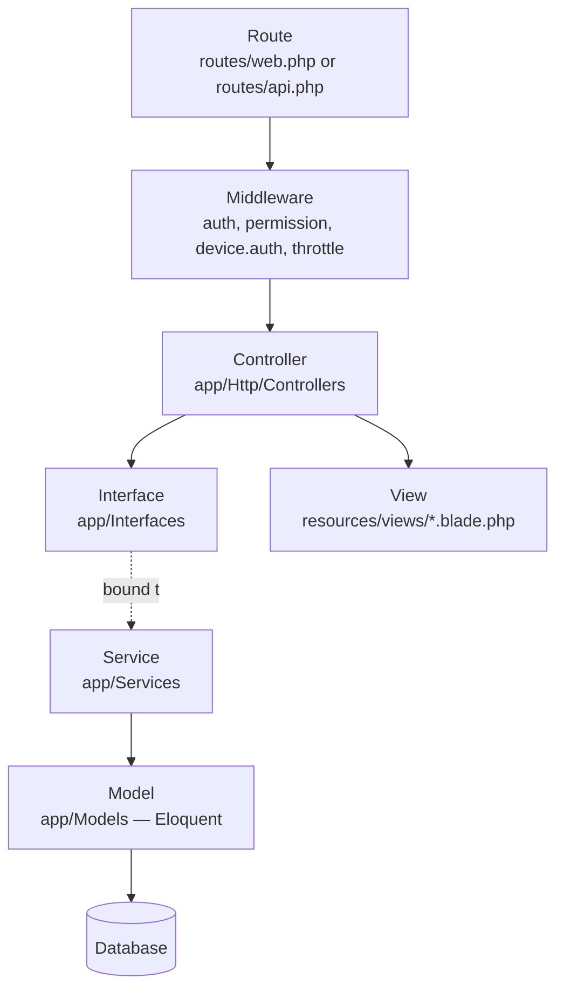
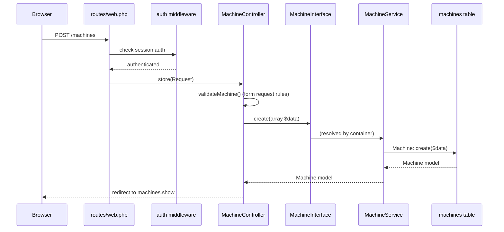
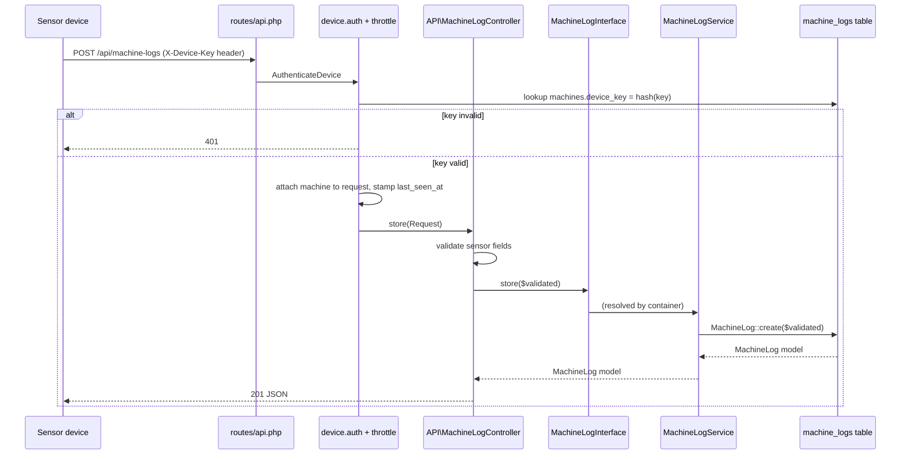
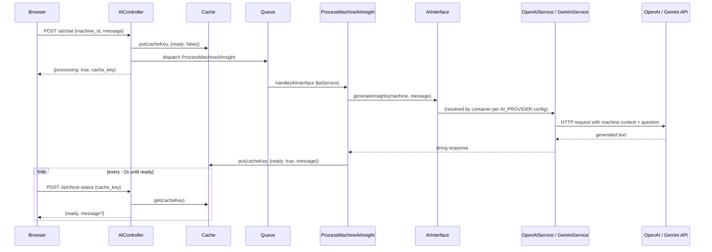

# Architecture

This is the core document for anyone writing code in this project. Read it before adding a route, controller, or service.

## Layered architecture

Every feature in this codebase flows through the same layers:



The binding between an Interface and its Service happens once, in [AppServiceProvider.php](../app/Providers/AppServiceProvider.php). Everywhere else in the app — controllers, jobs — code depends on the **interface**, never the concrete service class.

## Why interfaces, not just services?

1. **Swappable implementations.** `AIInterface` has two implementations, `OpenAIService` and `GeminiService`. Which one gets injected is decided by one line in `AppServiceProvider` based on the `AI_PROVIDER` env var — no controller or job code changes when you switch providers.
2. **Testability.** A feature test for `MachineController` can bind a fake `MachineInterface` in the container instead of hitting the real database-backed service.
3. **A stable contract.** The interface is the "menu" of what a module can do. Anyone consuming `BuildingInterface` doesn't need to know whether `getAllBuildings()` eager-loads relations, caches, or queries a different database — that's the service's business.

## Request lifecycles

### (a) A web CRUD request (e.g. creating a machine)



### (b) A sensor reading (device → machine_logs)



Note there is no user session involved in this flow at all — the device authenticates itself with its own key, independent of any logged-in user. See [05-device-api.md](05-device-api.md) and [06-security.md](06-security.md).

### (c) An AI chat request (queued + polled)



See [07-ai-insights.md](07-ai-insights.md) for details on context building and provider switching.

## Interface → Service → Controller: layer responsibilities

| Layer | Responsible for | Must NOT contain |
|---|---|---|
| **Route** (`routes/*.php`) | URI, HTTP verb, middleware stack, route name | Any logic |
| **Middleware** | Cross-cutting concerns: auth, permission checks, rate limiting, device authentication | Business logic specific to one feature |
| **Controller** (`app/Http/Controllers`) | Validating input, calling exactly one service method, choosing a view/response | Direct Eloquent queries, business rules, loops over data to compute derived values |
| **Interface** (`app/Interfaces`) | The typed contract for a module: method names, parameter types, return types | Any implementation |
| **Service** (`app/Services`) | All business logic and Eloquent queries for a module | HTTP concerns (Request/Response objects), rendering views |
| **Model** (`app/Models`) | Relationships, casts, scopes, small self-contained helpers (e.g. `Machine::generateDeviceKey()`) | Cross-model business logic that belongs in a service |
| **View** (`resources/views`) | Presentation only | Database queries, business rules (a `@php` block computing a derived stat is a smell — compute it in the service and pass it in) |

## Container binding registry

All bindings live in [AppServiceProvider.php](../app/Providers/AppServiceProvider.php):

| Interface | Bound to | Consumers |
|---|---|---|
| `BuildingInterface` | `BuildingService` | `BuildingController` |
| `FloorInterface` | `FloorService` | `FloorController` |
| `MachineInterface` | `MachineService` | `MachineController` |
| `MachineLogInterface` | `MachineLogService` | `API\MachineLogController` |
| `SuggestedQuestionInterface` | `SuggestedQuestionService` | `AIController` |
| `AIInterface` | `OpenAIService` **or** `GeminiService`, chosen at resolve time by `config('services.ai.provider')` (env `AI_PROVIDER`) | `ProcessMachineAIInsight` job |

`AIInterface`'s binding is a closure, not a plain class-string, because it's the one case in this app where the implementation is chosen at runtime:

```php
$this->app->bind(AIInterface::class, function ($app) {
    return match (config('services.ai.provider', 'openai')) {
        'gemini' => $app->make(GeminiService::class),
        default => $app->make(OpenAIService::class),
    };
});
```

Both `OpenAIService` and `GeminiService` share prompt-building logic via the `App\Services\Concerns\BuildsMachineContext` trait, so switching providers doesn't change what context the AI sees — only how the request is sent and parsed.

## Adding a new module

Follow this checklist for any new feature (e.g. Work Orders in Phase 7). Using a hypothetical `Widget` module as the example:

1. **Migration** — `php artisan make:migration create_widgets_table`. Define columns, indexes, FKs.
2. **Model** — `app/Models/Widget.php`. Fillable, casts, relationships, small scopes.
   ```php
   class Widget extends Model
   {
       protected $fillable = ['name', 'machine_id'];
       public function machine(): BelongsTo { return $this->belongsTo(Machine::class); }
   }
   ```
3. **Interface** — `app/Interfaces/WidgetInterface.php`. Every public method the controller needs, with real return types.
   ```php
   interface WidgetInterface
   {
       public function getAllPaginated(array $filters): LengthAwarePaginator;
       public function create(array $data): Widget;
       public function update(Widget $widget, array $data): Widget;
       public function delete(Widget $widget): bool;
   }
   ```
4. **Service** — `app/Services/WidgetService.php implements WidgetInterface`. All queries and business rules live here.
5. **Bind it** — in `AppServiceProvider::register()`:
   ```php
   $this->app->bind(WidgetInterface::class, WidgetService::class);
   ```
6. **Controller** — `app/Http/Controllers/WidgetController.php`, constructor-inject the interface:
   ```php
   public function __construct(protected WidgetInterface $widgets) {}
   ```
   Keep every method thin: validate → call the service → return a view/redirect/JSON.
7. **Routes** — add to `routes/web.php` inside the `auth` group (and a `permission:` middleware if the action should be restricted — see [06-security.md](06-security.md)).
8. **Views** — extend `layouts.app`, follow [08-frontend.md](08-frontend.md) conventions.
9. **Permission** (if needed) — add to `RolesAndPermissionsSeeder` and assign to the appropriate roles.
10. **Docs** — update `03-data-model.md` (new table), `04-routes.md` (new routes), `02-architecture.md` registry table (new interface row), `01-overview.md` module status, and add a `CHANGELOG.md` entry.

## Anti-patterns (don't do this)

- ❌ **Querying models directly in a controller.** If you write `Machine::where(...)->get()` inside a controller method, that logic belongs in the service.
- ❌ **Injecting a concrete service class instead of its interface.** `public function __construct(MachineService $s)` breaks the swappability the whole pattern exists for. Always type-hint the interface.
- ❌ **Business logic in Blade.** A `@php` block that computes days-until-overdue, filters a collection, or sums values is a sign the controller should have computed it and passed a ready-to-render value.
- ❌ **Skipping the interface "because it's simple."** Even a single-implementation module (like `MachineLogInterface`) gets an interface — consistency means nobody has to guess which modules follow the pattern.
- ❌ **Leaving a new interface unbound.** `FloorInterface` existed for a while with no binding in `AppServiceProvider` — because `FloorController` happened to inject the concrete `FloorService` directly instead of the interface, nothing ever tried to resolve `FloorInterface` and the gap went unnoticed. If any code had type-hinted the interface, it would have failed with "target is not instantiable." Always add the `bind()` line in the same commit you create the interface.
