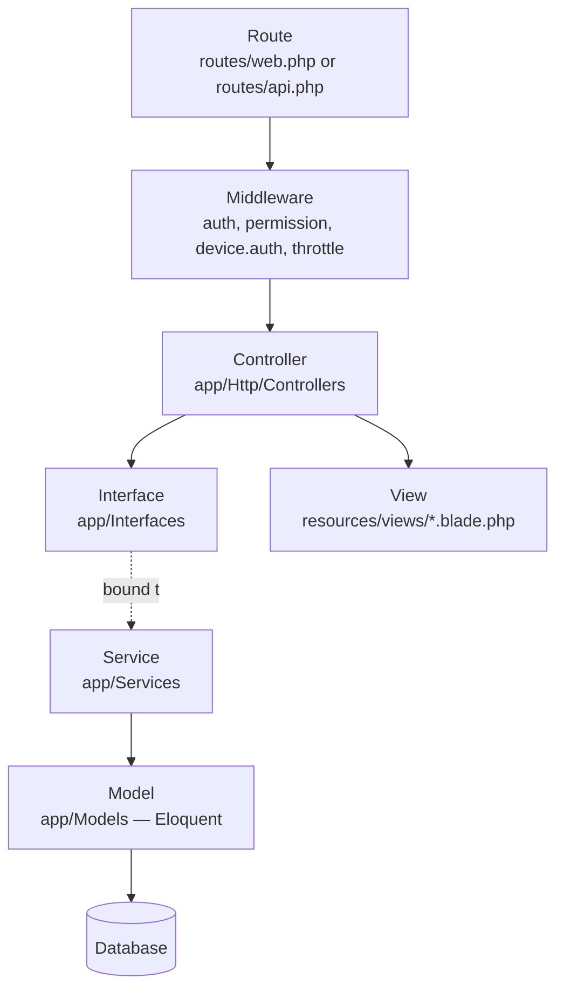
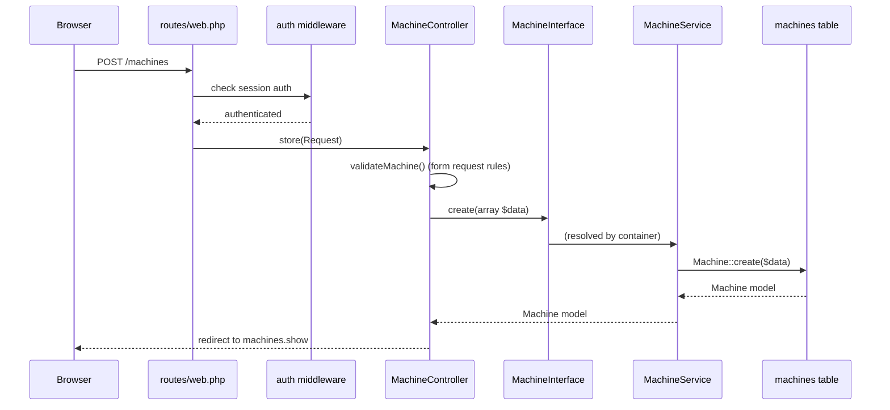
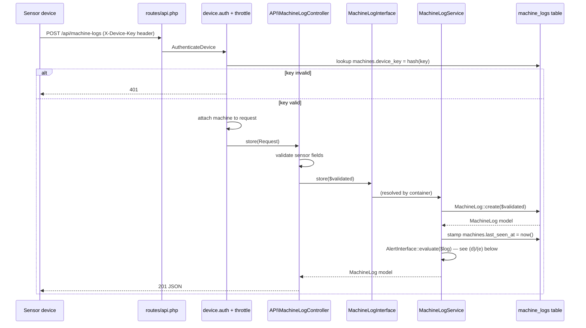
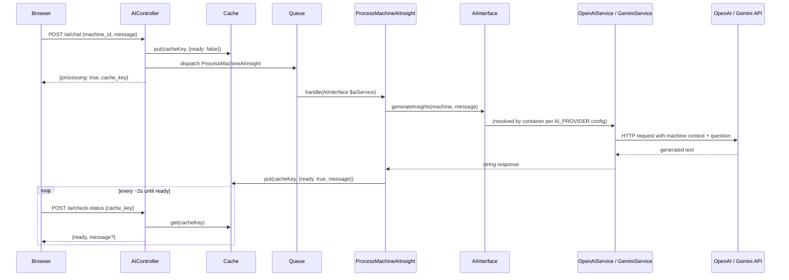
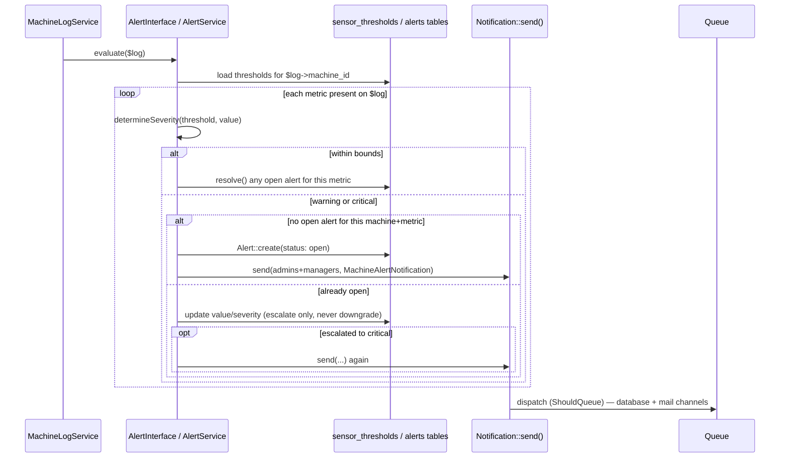
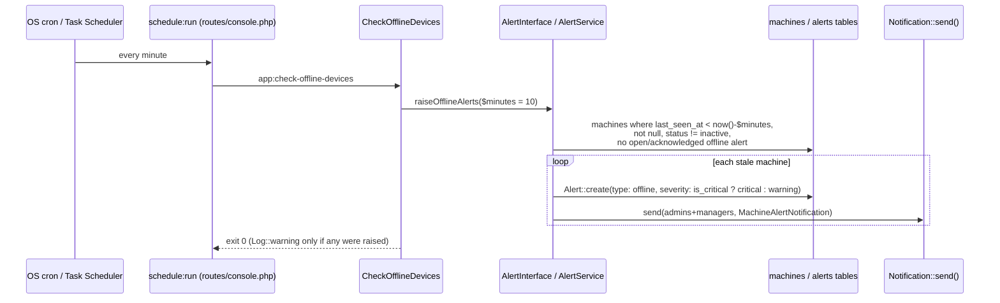
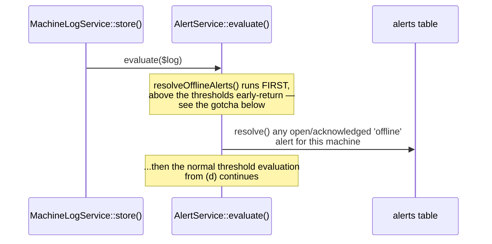

# Architecture

This is the core document for anyone writing code in this project. Read it before adding a route, controller, or service.

## Layered architecture

Every feature in this codebase flows through the same layers:



The binding between an Interface and its Service happens once, in [AppServiceProvider.php](../app/Providers/AppServiceProvider.php). Everywhere else in the app — controllers, jobs — code depends on the **interface**, never the concrete service class.

## Why interfaces, not just services?

1. **Swappable implementations.** `AIInterface` has two implementations, `OpenAIService` and `GeminiService`. Which one gets injected is decided by one line in `AppServiceProvider` based on the `AI_PROVIDER` env var — no controller or job code changes when you switch providers.
2. **Testability.** A feature test for `MachineController` can bind a fake `MachineInterface` in the container instead of hitting the real database-backed service.
3. **A stable contract.** The interface is the "menu" of what a module can do. Anyone consuming `BuildingInterface` doesn't need to know whether `getAllBuildings()` eager-loads relations, caches, or queries a different database — that's the service's business.

## Request lifecycles

### (a) A web CRUD request (e.g. creating a machine)



### (b) A sensor reading (device → machine_logs)



Note there is no user session involved in this flow at all — the device authenticates itself with its own key, independent of any logged-in user. See [05-device-api.md](05-device-api.md) and [06-security.md](06-security.md).

### (c) An AI chat request (queued + polled)



See [07-ai-insights.md](07-ai-insights.md) for details on context building and provider switching.

### (d) Threshold evaluation (`AlertService::evaluate()`, Phase 5)

Runs synchronously as the last step of `MachineLogService::store()` — every reading, not just ones from the sensor API, so a manually-logged reading gets the same alerting.



Key rules (all in `AlertService`, not the schema — see [03-data-model.md](03-data-model.md#alerts)):
- **One open alert per `(machine_id, metric)`.** A repeat breach updates the existing row instead of inserting a new one.
- **Severity only escalates while open** (`warning` → `critical`), never downgrades — a reading that's still abnormal but less severe than before leaves the alert as-is. Only a reading back within *both* bounds resolves it.
- **Notifications fire on creation and on escalation to critical**, not on every matching reading — this is what keeps "the same bad reading repeated" from spamming email.
- Recipients are every user with the `admin` or `manager` role (`User::role(['admin', 'manager'])`), resolved fresh on each call — not a stored subscriber list.

`MachineAlertNotification implements ShouldQueue` and sends on both the `database` channel (backs the header bell — see [08-frontend.md](08-frontend.md)) and `mail` (routes to `storage/logs/laravel.log` in dev, since `MAIL_MAILER=log`).

### (e) Offline detection (`app:check-offline-devices`, Phase 6)

Runs on a schedule rather than in response to a request — a silent device produces no request to react to.



The resolve side runs inline, not on a schedule — a reading arriving is itself the "device is back" signal:



**The early-return gotcha.** `evaluate()` loads the machine's `sensor_thresholds` and returns immediately if there are none (see (d)). `resolveOfflineAlerts()` is called *before* that check specifically so a machine with no configured thresholds can still clear its offline alert — placing it after would mean such a machine's offline alert could never resolve. This ordering has its own explicit comment in `AlertService::evaluate()`; don't reorder it.

**Idempotency** is enforced with `whereDoesntHave('alerts', type=offline, status in [open, acknowledged])` in the query itself, not a separate check — running the command every minute never re-raises or re-notifies for a machine already flagged. `last_seen_at IS NULL` (never commissioned) and `status = 'inactive'` (deliberately out of service) are both excluded from the query — see [03-data-model.md](03-data-model.md) for the reasoning.

### Scheduled commands

`routes/console.php` registers scheduled events (Laravel 12 loads them from the same file as `Artisan::command()` closures, via `withRouting(commands: ...)` in `bootstrap/app.php` — no separate `Kernel.php`):

```php
Schedule::command('app:check-offline-devices')->everyMinute()->withoutOverlapping();
Schedule::command('app:process-queue')->everyMinute()->withoutOverlapping();
Schedule::command('app:generate-preventive-work-orders')->dailyAt('01:00')->withoutOverlapping();
Schedule::command('model:prune', ['--model' => [MachineLog::class]])->daily();
```

The offline check is registered **first** among the per-minute entries deliberately: `schedule:run` executes due events sequentially in registration order, and `app:process-queue` can hold the process for up to ~50s (see its `--max-time`) — registering it first would delay the offline check by up to that long every run. The preventive-work-order generator (Phase 8) only needs to run once a day — `next_maintenance_date` doesn't change minute to minute, and its own dedupe (an existing open preventive work order blocks a new one) makes a missed run harmless, since the next run just catches up. `runInBackground()` is deliberately not used for any of them: it shells out using POSIX-style command construction, which doesn't behave correctly under Windows Task Scheduler, a supported production target here (see [09-setup-and-operations.md](09-setup-and-operations.md)). `withoutOverlapping()` needs a working cache lock — satisfied by `CACHE_STORE=database` with the cache table migrated.

`model:prune` (Phase 10) is passed `--model` explicitly rather than relying on Laravel's auto-discovery of every `Prunable` model under `app/Models` — `MachineLog` is the only one, and being explicit means a future `Prunable` model doesn't get silently swept by a schedule entry nobody wrote for it. See [Data retention](#data-retention-prunable-machinelog) below for what it deletes and why.

## Audit logging (`spatie/laravel-activitylog`)

`Machine`, `Building`, `WorkOrder`, and `Alert` use the `LogsActivity` trait, each defining `getActivitylogOptions()`:

```php
public function getActivitylogOptions(): LogOptions
{
    return LogOptions::defaults()
        ->logOnly($this->fillable)
        ->logOnlyDirty()
        ->dontSubmitEmptyLogs();
}
```

`logOnlyDirty()` + `dontSubmitEmptyLogs()` mean only attributes that actually changed are recorded, and a save with no real change writes nothing.

**`Alert` is the one exception**, and deliberately narrower — `logOnly(['status', 'severity'])` instead of the full `$fillable`:

```php
public function getActivitylogOptions(): LogOptions
{
    return LogOptions::defaults()->logOnly(['status', 'severity'])->logOnlyDirty()->dontSubmitEmptyLogs();
}
```

`AlertService::evaluate()` updates `value` and `machine_log_id` on the same open alert every time a matching reading arrives — for a metric stuck above threshold, that's once per sensor POST. Logging the full fillable set would flood the activity log with a row per reading instead of the state transitions (`open → acknowledged → resolved`, `warning → critical`) that are actually worth auditing.

**The machine page's Activity feed** (`MachineService::getActivityFeed()`) is not just `Machine::activities()` — a machine's own field changes are too sparse to tell a useful story alone. It unions activity on the machine itself with activity on its work orders and alerts via a `subject_type`/`subject_id` query:

```php
public function getActivityFeed(Machine $machine, int $limit = 20): Collection
{
    $workOrderIds = $machine->workOrders()->pluck('id');
    $alertIds = $machine->alerts()->pluck('id');

    return Activity::query()
        ->where(function (Builder $query) use ($machine, $workOrderIds, $alertIds) {
            $query->where(fn ($q) => $q->where('subject_type', Machine::class)->where('subject_id', $machine->id))
                ->orWhere(fn ($q) => $q->where('subject_type', WorkOrder::class)->whereIn('subject_id', $workOrderIds))
                ->orWhere(fn ($q) => $q->where('subject_type', Alert::class)->whereIn('subject_id', $alertIds));
        })
        ->with('causer')->latest()->limit($limit)->get();
}
```

This gives one combined timeline — "who changed what on this machine, and what happened to the work orders and alerts raised against it" — instead of three separate, sparser feeds.

## Data retention: `Prunable` `MachineLog`

`MachineLog` uses Laravel's `Prunable` trait rather than a hand-rolled cleanup command, so `model:prune` (see [Scheduled commands](#scheduled-commands) above) handles deletion in chunks with the framework's usual `ModelsPruned` event:

```php
public function prunable(): Builder
{
    $days = app(SettingInterface::class)->get('log_retention_days', 365);

    return static::where('logged_at', '<', now()->subDays($days));
}
```

The cutoff is read from the `log_retention_days` setting (default 365) on every run rather than being a fixed constant, so lowering it in Settings takes effect on the very next scheduled prune with no deploy.

## Interface → Service → Controller: layer responsibilities

| Layer | Responsible for | Must NOT contain |
|---|---|---|
| **Route** (`routes/*.php`) | URI, HTTP verb, middleware stack, route name | Any logic |
| **Middleware** | Cross-cutting concerns: auth, permission checks, rate limiting, device authentication | Business logic specific to one feature |
| **Controller** (`app/Http/Controllers`) | Validating input, calling exactly one service method, choosing a view/response | Direct Eloquent queries, business rules, loops over data to compute derived values |
| **Interface** (`app/Interfaces`) | The typed contract for a module: method names, parameter types, return types | Any implementation |
| **Service** (`app/Services`) | All business logic and Eloquent queries for a module | HTTP concerns (Request/Response objects), rendering views |
| **Model** (`app/Models`) | Relationships, casts, scopes, small self-contained helpers (e.g. `Machine::generateDeviceKey()`) | Cross-model business logic that belongs in a service |
| **View** (`resources/views`) | Presentation only | Database queries, business rules (a `@php` block computing a derived stat is a smell — compute it in the service and pass it in) |

## Container binding registry

All bindings live in [AppServiceProvider.php](../app/Providers/AppServiceProvider.php):

| Interface | Bound to | Consumers |
|---|---|---|
| `BuildingInterface` | `BuildingService` | `BuildingController` |
| `FloorInterface` | `FloorService` | `FloorController` |
| `MachineInterface` | `MachineService` | `MachineController` |
| `MachineLogInterface` | `MachineLogService` | `API\MachineLogController` |
| `MachineTypeInterface` | `MachineTypeService` | `MachineTypeController`, `MachineController` (Type select options + per-field validation rules on create/edit) |
| `SuggestedQuestionInterface` | `SuggestedQuestionService` | `AIController` |
| `AIInterface` | `OpenAIService` **or** `GeminiService`, chosen at resolve time by `config('services.ai.provider')` (env `AI_PROVIDER`) | `ProcessMachineAIInsight` job |
| `UserInterface` | `UserService` | `UserController` |
| `RoleInterface` | `RoleService` | `RoleController` |
| `PermissionInterface` | `PermissionService` | `RoleController`, `PermissionController` |
| `AlertInterface` | `AlertService` | `MachineLogService` (evaluates every reading), `MachineController` (thresholds + active-alerts card), `AlertController`, `WorkOrderService` (resolves the linked alert on completion) |
| `WorkOrderInterface` | `WorkOrderService` | `WorkOrderController`, `app:generate-preventive-work-orders` |
| `SearchInterface` | `SearchService` | `SearchController` (header live search — `searchMachines()` uses `Machine::scopeSearch()`, the same scope the machines DataTable's search override uses) |
| `MaintenanceInterface` | `MaintenanceService` | `MaintenanceController`, `ReportService` (reuses `getStats()`/`getBuildingBreakdown()`/`getQueryForDataTable()` for the maintenance compliance report rather than recomputing its rules) |
| `DashboardInterface` | `DashboardService` | `HomeController` |
| `ReportInterface` | `ReportService` | `ReportController` |
| `SettingInterface` | `SettingService` (cached with `Cache::rememberForever`, invalidated on every `update()`) | `SettingController`, `CheckOfflineDevices`, `GeneratePreventiveWorkOrders`, `AlertService` (extra alert emails, auto-fault toggle), `MachineService` (default thresholds for new machines), `MachineLog::prunable()`, `AppServiceProvider`'s `layouts.app` view composer (site-wide `$companyName`) |

`AIInterface`'s binding is a closure, not a plain class-string, because it's the one case in this app where the implementation is chosen at runtime:

```php
$this->app->bind(AIInterface::class, function ($app) {
    return match (config('services.ai.provider', 'openai')) {
        'gemini' => $app->make(GeminiService::class),
        default => $app->make(OpenAIService::class),
    };
});
```

Both `OpenAIService` and `GeminiService` share prompt-building logic via the `App\Services\Concerns\BuildsMachineContext` trait, so switching providers doesn't change what context the AI sees — only how the request is sent and parsed.

## Permission gating lives on the controller, not the route

As of Phase 4, CRUD controllers (`BuildingController`, `FloorController`, `MachineController`, `UserController`) gate their actions by registering middleware in the constructor rather than splitting `Route::resource()` into individual route definitions:

```php
public function __construct(protected MachineInterface $machineService)
{
    $this->middleware('permission:machines.view')->only(['index', 'show']);
    $this->middleware('permission:machines.create')->only(['create', 'store']);
    $this->middleware('permission:machines.update')->only(['edit', 'update']);
    $this->middleware('permission:machines.delete')->only(['destroy', 'confirmDelete']);
}
```

This works because this app's base `Controller` (`Illuminate\Routing\Controller`) still supports the classic `$this->middleware()` registration — Laravel's router checks for a `getMiddleware()` method on the controller and merges it in (`Route::controllerMiddleware()`). It keeps `Route::resource('machines', MachineController::class)` as a single line in `routes/web.php` while still gating each action individually. The one exception is a non-resource action like `machines.device-key.generate`, which gets its permission middleware directly on the route definition instead, since it isn't part of the constructor's action groups.

See [06-security.md](06-security.md) for the full permission list and the role → permission matrix.

## Business-rule violations: services throw, controllers catch

`RoleService` enforces rules that aren't simple validation (a role can't be deleted while users hold it, the `admin` role can't be modified, an admin can't strip their own role-management permission) by throwing `App\Exceptions\RoleActionException` rather than returning a boolean or null. This keeps the rule itself — and its message — in one place in the service, instead of the controller having to re-check conditions the service already knows about:

```php
// RoleService
if ($userCount > 0) {
    throw new RoleActionException("Cannot delete \"{$role->name}\" — {$userCount} user(s) still have this role...");
}

// RoleController
try {
    $this->roles->delete($role);
} catch (RoleActionException $e) {
    return redirect()->route('roles.index')->with('error', $e->getMessage());
}
```

Use this pattern — a small exception class under `app/Exceptions/`, named after the domain rule it protects (not `ValidationException`, which is for request-shape validation, not business rules) — whenever a service needs to refuse an otherwise well-formed request for a reason the controller shouldn't have to know in advance.

A second example: `WorkOrderService::updateStatus()` throws `App\Exceptions\WorkOrderActionException` when a technician (anyone without `work-orders.update`) tries to change the status of a work order that isn't assigned to them:

```php
// WorkOrderService
if (!$actor->can('work-orders.update') && $workOrder->assigned_to !== $actor->id) {
    throw new WorkOrderActionException('You can only update the status of work orders assigned to you.');
}

// WorkOrderController
try {
    $this->workOrderService->updateStatus($workOrder, $validated['status'], $request->user(), $validated['resolution_notes'] ?? null);
} catch (WorkOrderActionException $e) {
    return back()->with('error', $e->getMessage());
}
```

Note the rule is expressed in terms of a **permission the actor holds**, not a hardcoded role name check (`$actor->can('work-orders.update')`, not `$actor->hasRole('technician')`) — this is deliberate: it means the restriction automatically applies to any future role that gets `work-orders.update-status` without the broader `work-orders.update`, with no code change.

## List pages: server-side DataTables, with the layering intact

As of Phase 4c, every list page whose row count can grow past a screenful is a server-side [Yajra DataTable](https://yajrabox.com/docs/laravel-datatables) rather than a Laravel paginator or an unbounded `->get()`. `yajra/laravel-datatables` was already in `composer.json` before this — it's the server-side PHP half only (it builds the JSON response DataTables' JS expects); it ships no browser assets. jQuery + the DataTables JS/CSS come from CDN via a shared partial, [`resources/views/partials/_datatables-assets.blade.php`](../resources/views/partials/_datatables-assets.blade.php), included only on pages with a table.

**The pattern keeps each layer's job the same as everywhere else in the app:**

| Layer | Responsibility |
|---|---|
| Service (`app/Services`) | A `getQueryForDataTable(array $filters): Builder` method — decides which columns, joins and filters apply. Returns a query **Builder**, never a `JsonResponse` — services still don't know about HTTP, matching the rule in the layer-responsibilities table above. |
| `app/DataTables/*DataTable` class | Yajra's `Services\DataTable`. `query()` calls the service's `getQueryForDataTable()`; `dataTable($query)` wires up column formatting (`addColumn`/`editColumn`/`rawColumns`) and any custom search override (`filter()`). Depends on the module's **interface**, like every other consumer in the registry table. `html()` is left at its default (unused) — the `<table>` markup is hand-written Blade, not generated, so it matches the rest of the app's views. |
| Controller | One line: `public function data(MachinesDataTable $dataTable) { return $dataTable->ajax(); }`. The `/data` route carries the same `permission:` middleware as the page's `index`/`show` route. |
| View | A bare `<table id="...">` with just a `<thead>` (no `<tbody>` rows — those come from ajax), plus a small inline `$(...).DataTable({...})` script setting `serverSide: true`, `ajax: {url, data: function(d) {...}}` for any filter dropdowns, and `autoWidth: false` (see the gotcha below). |

Action-button cells (View/Edit/Delete) render through a small Blade partial (e.g. [`buildings/_datatable-actions.blade.php`](../resources/views/buildings/_datatable-actions.blade.php)) called from an `addColumn()` closure, so `@can` gating still applies per row exactly as it does on a normal page — verified by hitting the `/data` endpoint as different roles and confirming the returned HTML omits buttons the role can't use.

**Two layout-specific gotchas**, both handled once in the shared assets partial rather than per page:
1. The main layout hides `#actual-content` (`display:none`) and reveals it ~300ms after `window.load` (see [08-frontend.md](08-frontend.md)). A table initialised while hidden measures zero-width columns — every table sets `autoWidth: false`, and the assets partial re-runs `columns.adjust()` on all visible tables ~400ms after load as a safety net.
2. The Tailwind v4 **browser** CDN compiler generates utility classes by scanning the DOM present at page load. DOM that DataTables injects afterward (its pager, length select, search box) won't reliably get Tailwind classes generated for it, so the assets partial uses DataTables' own stylesheet plus a small CSS override block to blend it with the DaisyUI `forest` theme, instead of trying to style DataTables' own markup with Tailwind utility classes.

**Server-side vs. client-side** — not every table needs an ajax endpoint. `roles/show`'s "users with this role" table and `permissions/index` are rendered fully server-side in the initial page load (small, fixed-size data) and DataTables is initialised on them with no `ajax`/`serverSide` option at all — it just adds sort/search/paging on top of the rows already in the DOM. Reach for server-side only when the table's row count scales with real-world usage (buildings, machines, and especially `machine_logs`, which grows with every sensor reading).

**What this replaced**: `BuildingService::getAllBuildings()` was an unbounded `Building::with(['floors','machines'])->get()`, and the controller summed the loaded collection in PHP for stat tiles; `MachineService::getAllPaginated()` and `getLogsForMachine()` used Laravel's paginator. All three were removed (not deprecated — nothing else called them) in favor of `getQueryForDataTable()` methods, and `BuildingService` gained a proper `getStats()` (count queries, mirroring `MachineService::getStats()`) instead of summing a loaded collection.

## Streamed CSV exports (Phase 9)

Reports (`ReportController@export`) is the app's first CSV export, and the first place a controller iterates over a query result to build response rows. This looks like it brushes against the "no loops to compute derived values" anti-pattern below, but it isn't one: the loop does no business logic or domain calculation — it only picks which model attributes go in which CSV column, the same kind of pure structural mapping a DataTables `addColumn()` closure or an API Resource class does, both of which are presentation-layer concerns that live outside the service layer in this app.

The pattern:

```php
// ReportService — the query, filtered and eager-loaded, but not iterated
public function getAlertHistoryQuery(array $filters): Builder
{
    $query = Alert::with('machine')->orderByDesc('created_at');
    // ...date range / building filters...
    return $query;
}

// ReportController — iterates via cursor() and yields formatted rows into a generator
private function alertHistoryRows(array $filters): \Generator
{
    foreach ($this->reportService->getAlertHistoryQuery($filters)->cursor() as $alert) {
        yield [$alert->created_at->format('Y-m-d H:i'), $alert->machine->name ?? '—', /* ... */];
    }
}

// One shared helper wraps any such generator in a streamed HTTP response
private function csvResponse(string $filename, array $headers, iterable $rows): StreamedResponse
{
    return response()->streamDownload(function () use ($headers, $rows) {
        $handle = fopen('php://output', 'w');
        fputcsv($handle, $headers);
        foreach ($rows as $row) { fputcsv($handle, $row); }
        fclose($handle);
    }, $filename, ['Content-Type' => 'text/csv']);
}
```

`cursor()`, not `get()`, on every query-backed export (`alert_history`, `work_order_summary`, `maintenance_compliance`) — it hydrates one model at a time instead of loading the whole matching result set into memory first, so exporting a large date range doesn't scale the request's memory with the row count. `sensor_summary` is the one exception: it's already a small, pre-aggregated per-machine `Collection` (bounded by machine count, not reading count), so no cursor is needed. The on-page report view separately caps its **preview** table to 100 rows (`ReportService::PREVIEW_LIMIT`) for the same reason a DataTable paginates — the full data only ever needs to reach the browser via the CSV.

## Shared view data: View Composers, not `@php` queries

The header bell's unread count and recent-notifications list are needed on every authenticated page, but the layout files (`layouts/app.blade.php`, `layouts/header.blade.php`) aren't rendered by a single controller action, so there's no one `compact(...)` call to hand them a variable. Rather than a `@php $count = auth()->user()->unreadNotifications()->count(); @endphp` block in the view (a query in Blade — the anti-pattern below), `AppServiceProvider::boot()` registers a `View::composer()`:

```php
View::composer(['layouts.app', 'layouts.header'], function ($view) {
    $user = Auth::user();
    $view->with('unreadAlertCount', $user ? $user->unreadNotifications()->count() : 0);
    $view->with('recentAlertNotifications', $user ? $user->notifications()->latest()->limit(5)->get() : collect());
});
```

Both views need the data explicitly listed since a composer only fires for the exact view name it's registered against, even though `header` is always `@include`d from `app`. Reach for a composer only for genuinely cross-cutting, layout-level data like this — a single page's own data still belongs in its controller action passing a `compact(...)`/`view(..., [...])` payload, not a composer.

The sidebar's company name/logo heading (Phase 10) is the same pattern, one composer down:

```php
View::composer('layouts.app', function ($view) {
    $view->with('companyName', $this->app->make(SettingInterface::class)->get('company_name'));
});
```

## Editions & module toggles: two-layer enforcement

A deployment can switch whole modules off (`APP_EDITION=lite`, or `MODULE_<NAME>=false` — operational detail in [09-setup-and-operations.md](09-setup-and-operations.md#editions--module-toggles)). The switchable modules are the cases of [AppModule](../app/Enums/AppModule.php) (`buildings`, `work-orders`, `maintenance`, `reports`), each owning the permission prefixes it seeds (`buildings` owns `buildings.*` *and* `floors.*`); the values come from [config/modules.php](../config/modules.php). Enforcement has two layers, deliberately, because a module's UI and its endpoints are guarded differently in this app:

1. **A `Gate::before` in `AppServiceProvider::register()`** returns `false` for any ability whose prefix belongs to a disabled module (`AppModule::isAbilityDisabled()`), and `null` otherwise. Because this app already gates everything through `@can`/`@canany` and `permission:` controller middleware, that one hook automatically hides every gated sidebar item, dashboard button and "Create Work Order" link, and turns every `permission:work-orders.*` check into a 403 — for admin too.

   > **It must be registered in `register()`, not `boot()`.** `spatie/laravel-permission` adds its own `Gate::before` in its provider's `boot()`, and Gate callbacks run in registration order with the first non-null result winning. Admin holds every permission, so Spatie's callback would grant `work-orders.create` before ours could deny it. Every `register()` runs before any `boot()`, which is what puts ours first. `EditionModulesTest::test_admin_is_denied_a_switched_off_modules_abilities…` guards this ordering.

2. **`module:{name}` route middleware** ([EnsureModuleEnabled](../app/Http/Middleware/EnsureModuleEnabled.php), aliased in `bootstrap/app.php`) wraps each switchable module's route group in `routes/web.php` and answers **404**. The routes stay *registered* so a `route('buildings.show', …)` call in a shared view never throws `RouteNotFoundException` — the page simply doesn't exist in that edition. A 404 (not 403) is intentional: the feature isn't forbidden, it isn't there.

**For UI that isn't already behind an `@can`** (the Building/Floor selects on the machine form, the Buildings sidebar link, a Building column in a DataTable), use the `@module('buildings') … @endmodule` Blade directive (registered with `Blade::if` in `AppServiceProvider::boot()`; `@else` works too). An unknown module name counts as enabled, so a typo can't silently hide a section. When a *required* form field would be hidden this way (Settings' `preventive_lead_days`), carry its value through as a hidden input rather than weakening the controller's validation.

**Services and controllers stay module-aware only where data is computed for a hidden feature:** `DashboardService` skips the work-order/building stats and returns empty collections for a disabled module rather than querying and hiding; `MachineController::validateMachine()` drops `building_id`/`floor_id` when Buildings is off (so a hand-crafted POST can't set them and an edit leaves the existing location alone); `PermissionService` hides a disabled module's permissions from the matrix and `RoleService::update()` carries over whatever a role already holds for them.

**HTML comments name modules too.** A `<!-- Building Health -->` comment outside an `@module` block is still emitted into the page of an edition that has no Building Health — harmless to users, but it makes "the page doesn't mention X" assertions lie. Use `{{-- … --}}` for section labels around switchable UI.

## Adding a new module

Follow this checklist for any new feature (e.g. Work Orders in Phase 7). Using a hypothetical `Widget` module as the example:

1. **Migration** — `php artisan make:migration create_widgets_table`. Define columns, indexes, FKs.
2. **Model** — `app/Models/Widget.php`. Fillable, casts, relationships, small scopes.
   ```php
   class Widget extends Model
   {
       protected $fillable = ['name', 'machine_id'];
       public function machine(): BelongsTo { return $this->belongsTo(Machine::class); }
   }
   ```
3. **Interface** — `app/Interfaces/WidgetInterface.php`. Every public method the controller needs, with real return types. If the module has a list page, that method is `getQueryForDataTable()` (see the DataTables section above), not a paginator:
   ```php
   interface WidgetInterface
   {
       public function getQueryForDataTable(array $filters): Builder;
       public function create(array $data): Widget;
       public function update(Widget $widget, array $data): Widget;
       public function delete(Widget $widget): bool;
   }
   ```
4. **Service** — `app/Services/WidgetService.php implements WidgetInterface`. All queries and business rules live here.
5. **Bind it** — in `AppServiceProvider::register()`:
   ```php
   $this->app->bind(WidgetInterface::class, WidgetService::class);
   ```
6. **Controller** — `app/Http/Controllers/WidgetController.php`, constructor-inject the interface:
   ```php
   public function __construct(protected WidgetInterface $widgets) {}
   ```
   Keep every method thin: validate → call the service → return a view/redirect/JSON. The list-page action stays a one-liner: `public function data(WidgetsDataTable $dt) { return $dt->ajax(); }`.
7. **DataTable class** (if the module has a list page) — `app/DataTables/WidgetsDataTable.php`, per the pattern above.
8. **Routes** — add to `routes/web.php` inside the `auth` group (and a `permission:` middleware if the action should be restricted — see [06-security.md](06-security.md)). If there's a `WidgetController@data` route and also a `Route::resource('widgets', ...)`, register `/widgets/data` **before** the resource call — see the ordering comment in `routes/web.php`.
9. **Views** — extend `layouts.app`, follow [08-frontend.md](08-frontend.md) conventions. List pages include `partials._datatables-assets` and render a bare `<table>` with no `<tbody>` rows.
10. **Permission** (if needed) — add to `RolesAndPermissionsSeeder` and assign to the appropriate roles.
11. **Switchable?** — if a deployment could reasonably want this module off (anything beyond the machines/users/alerts/sensor-API core), add a case to `App\Enums\AppModule` (with its permission prefixes) and a `config/modules.php` entry, wrap its routes in `Route::middleware('module:…')`, and wrap any UI that isn't already behind an `@can` in `@module('…')`. See [Editions & module toggles](#editions--module-toggles-two-layer-enforcement).
12. **Docs** — update `03-data-model.md` (new table), `04-routes.md` (new routes), `02-architecture.md` registry table (new interface row), `01-overview.md` module status, and add a `CHANGELOG.md` entry.

## Anti-patterns (don't do this)

- ❌ **Querying models directly in a controller.** If you write `Machine::where(...)->get()` inside a controller method, that logic belongs in the service.
- ❌ **Injecting a concrete service class instead of its interface.** `public function __construct(MachineService $s)` breaks the swappability the whole pattern exists for. Always type-hint the interface.
- ❌ **Business logic in Blade.** A `@php` block that computes days-until-overdue, filters a collection, or sums values is a sign the controller should have computed it and passed a ready-to-render value.
- ❌ **Skipping the interface "because it's simple."** Even a single-implementation module (like `MachineLogInterface`) gets an interface — consistency means nobody has to guess which modules follow the pattern.
- ❌ **Leaving a new interface unbound.** `FloorInterface` existed for a while with no binding in `AppServiceProvider` — because `FloorController` happened to inject the concrete `FloorService` directly instead of the interface, nothing ever tried to resolve `FloorInterface` and the gap went unnoticed. If any code had type-hinted the interface, it would have failed with "target is not instantiable." Always add the `bind()` line in the same commit you create the interface.
- ❌ **An unbounded `->get()` (or a Laravel paginator) backing a list view.** `BuildingService::getAllBuildings()` used to be exactly this — fine at a handful of buildings, but it would have degraded the same way `machine_logs` would if every sensor reading were loaded into memory to render a table. Any list page whose data grows with real usage gets a `getQueryForDataTable()` + server-side DataTable per the pattern above; a plain paginated `->get()` is only acceptable for genuinely small, fixed-size lists (see "server-side vs. client-side" in that section).
