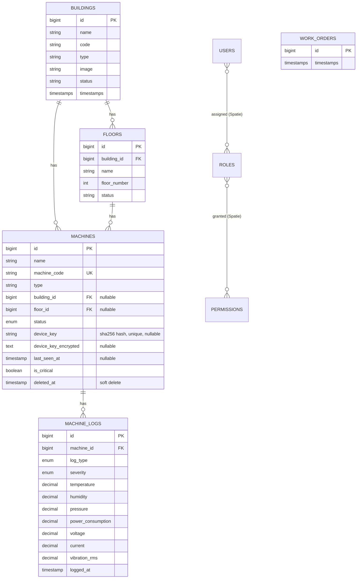

# Data Model

## Entity relationship diagram

`WORK_ORDERS`, `MACHINE_STATUSES` and `LOG_TYPES` are currently empty placeholder tables (`id` + `timestamps` only) — see [Placeholder tables](#placeholder-tables-not-yet-used) below.

## Tables

### `buildings`

Migration: [2026_02_18_074259_create_buildings_table.php](../database/migrations/2026_02_18_074259_create_buildings_table.php)

| Column | Type | Nullable | Notes |
|---|---|---|---|
| id | bigint PK | | |
| name | string | | |
| code | string | ✓ | building code, unique in practice (enforced at controller-validation level, not a DB constraint) |
| type | string | ✓ | one of: Production Facility, Warehouse, Office Building, R&D Center, Distribution Center (enforced by controller validation, not a DB enum) |
| image | string | ✓ | path under `storage/app/public/buildings` |
| address, city, state, country | string | ✓ | |
| year_built | integer | ✓ | |
| emergency_contact_name, emergency_contact_phone | string | ✓ | |
| status | string | ✓ | Operational, Under Construction, Maintenance, Inactive (controller-validated) |
| notes | text | ✓ | |
| timestamps | | | |

**Relationships** ([Building.php](../app/Models/Building.php)): `hasMany(Floor)`, `hasMany(Machine)`.

**Delete behaviour**: `Building::boot()` registers a `deleting` event that calls `$building->floors()->delete()` and `$building->machines()->delete()`. Floors have no soft-deletes, so this is a **hard delete**. Machines use `SoftDeletes`, so this is a **soft delete** (sets `deleted_at`). There is no DB-level `ON DELETE CASCADE` on these — the cascade is application-level, in the model's boot method.

### `floors`

Migration: [2026_02_18_082718_create_floors_table.php](../database/migrations/2026_02_18_082718_create_floors_table.php)

| Column | Type | Nullable | Notes |
|---|---|---|---|
| id | bigint PK | | |
| building_id | bigint FK → buildings.id | | `onDelete('cascade')` at the DB level |
| name | string | | |
| floor_number | integer | ✓ | |
| description | text | ✓ | |
| status | string | ✓ | active/inactive/maintenance (controller-validated) |
| timestamps | | | |

**Relationships** ([Floor.php](../app/Models/Floor.php)): `belongsTo(Building)`, `hasMany(Machine)`. No `SoftDeletes`.

### `machines`

Migrations: [2026_02_19_142824_create_machines_table.php](../database/migrations/2026_02_19_142824_create_machines_table.php), [add_device_key_to_machines_table](../database/migrations/2026_09_26_063758_add_device_key_to_machines_table.php), [add_device_key_encrypted_to_machines_table](../database/migrations/2026_09_26_070637_add_device_key_encrypted_to_machines_table.php)

| Column | Type | Nullable | Notes |
|---|---|---|---|
| id | bigint PK | | |
| name | string | | |
| machine_code | string | | **unique** |
| type | string | | HVAC, Generator, Elevator, Pump, etc. — free text, indexed |
| manufacturer, model_number, serial_number | string | ✓ | |
| building_id | bigint FK → buildings.id | ✓ | `onDelete('set null')`, indexed |
| floor_id | bigint FK → floors.id | ✓ | `onDelete('set null')`, indexed |
| description | text | ✓ | |
| status | enum | | `active`, `inactive`, `maintenance`, `fault` — default `active` |
| power_rating | decimal(10,2) | ✓ | kW |
| ip_address | string | ✓ | |
| installation_date, last_maintenance_date, next_maintenance_date | date | ✓ | |
| maintenance_interval_days | integer | ✓ | |
| capacity_tons, spec_voltage, fuel, autostart | mixed | ✓ | HVAC/generator-specific specs |
| capacity_persons, speed_m_s | mixed | ✓ | elevator-specific specs |
| flow_lpm, head_m | mixed | ✓ | pump-specific specs |
| cells, makeup_valve | mixed | ✓ | cooling-tower-specific specs |
| is_critical | boolean | | default `false`, indexed |
| **device_key** | string(64) | ✓ | SHA-256 hash of the device's plaintext API key. **Unique.** Never exposed as plaintext — see below. |
| **device_key_encrypted** | text | ✓ | `Crypt::encryptString()` of the plaintext key, so it can be decrypted and shown again to an authorized user. |
| **last_seen_at** | timestamp | ✓ | Updated every time a sensor reading is accepted for this machine. |
| deleted_at | timestamp | ✓ | `SoftDeletes` |
| timestamps | | | |

**Why two device-key columns?** `device_key` (a one-way hash) is what `AuthenticateDevice::handle()` looks up against on every sensor request — fast, indexed, unique, and even a full DB dump doesn't reveal a usable key. `device_key_encrypted` is a two-way encrypted copy (using the app's `APP_KEY`) that exists purely so a user with the `machines.view-device-key` permission can view/copy the key again later without regenerating it. See [Machine.php](../app/Models/Machine.php) (`generateDeviceKey()`, `decryptDeviceKey()`, `findByDeviceKey()`) and [06-security.md](06-security.md).

Both columns are in the model's `$hidden` array, so they never appear in `toArray()`/`toJson()` output even accidentally.

**Relationships** ([Machine.php](../app/Models/Machine.php)): `belongsTo(Building)`, `belongsTo(Floor)`, `hasMany(MachineLog)` (as `logs()`).

**Scopes**: `active()`, `critical()`, `byBuilding($id)`, `byFloor($id)`.

**Casts**: decimals cast to `decimal:2`/`decimal:3` strings, dates cast to `date`, `last_seen_at` cast to `datetime`, booleans cast to `boolean`.

### `machine_logs`

Migration: [2026_02_19_142853_create_machine_logs_table.php](../database/migrations/2026_02_19_142853_create_machine_logs_table.php)

This is the sensor/event log table — every reading from a device and every manual event (status change, maintenance note, alarm) is one row here.

| Column | Type | Nullable | Notes |
|---|---|---|---|
| id | bigint PK | | |
| machine_id | bigint FK → machines.id | | `onDelete('cascade')` |
| log_type | enum | | `status_change`, `maintenance`, `alarm`, `sensor_reading`, `operation`, `error` |
| event | string | ✓ | short description |
| severity | enum | | `info` (default), `warning`, `error`, `critical` |
| previous_status, current_status | string | ✓ | used for `status_change` logs |
| temperature | decimal(8,2) | ✓ | °C, can be negative |
| humidity | decimal(5,2) | ✓ | 0–100% |
| pressure | decimal(10,2) | ✓ | bar, can be negative |
| power_consumption | decimal(10,2) | ✓ | kW, non-negative |
| voltage | decimal(8,2) | ✓ | non-negative |
| current | decimal(8,2) | ✓ | non-negative |
| frequency | decimal(8,2) | ✓ | non-negative |
| runtime_hours | integer | ✓ | non-negative |
| vibration_rms | decimal(8,3) | ✓ | non-negative |
| bearing_temp | decimal(8,2) | ✓ | °C, can be negative |
| oil_level | decimal(6,2) | ✓ | non-negative |
| notes | text | ✓ | |
| performed_by | string | ✓ | free text — a user's name, or "system"/the device identifier |
| logged_at | timestamp | | defaults to `CURRENT_TIMESTAMP` at the DB level; app also defaults it in `MachineLogService::store()` if omitted |
| timestamps | | | separate from `logged_at` — `created_at`/`updated_at` track when the *row* was written, `logged_at` is when the *event* happened |

Indexes: `(machine_id, logged_at)`, `(log_type, severity)`, `logged_at`, `severity`.

**Relationships** ([MachineLog.php](../app/Models/MachineLog.php)): `belongsTo(Machine)`.

**Scopes**: `alerts()` (severity in error/critical), `byType($type)`, `recent($days = 7)`, `bySeverity($severity)`.

### Placeholder tables (not yet used)

These three tables exist as migrations but have **no columns beyond `id` and `timestamps`**, and their models ([WorkOrder.php](../app/Models/WorkOrder.php), [MachineStatus.php](../app/Models/MachineStatus.php), [LogType.php](../app/Models/LogType.php)) have no fillable/casts/relations:

- **`work_orders`** — will be built out in Phase 7 with real columns (title, machine_id, priority, status, assigned_to, etc.).
- **`machine_statuses`** — not used; `machines.status` is a plain enum column instead. Planned for removal in Phase 10.
- **`log_types`** — not used; `machine_logs.log_type` is a plain enum column instead. Planned for removal in Phase 10.

### Auth & permissions tables

- **`users`** — standard Laravel auth table (`name`, `email`, `password`, etc.). Uses Spatie's `HasRoles` trait.
- **`personal_access_tokens`** — Sanctum, used only by `GET /api/user`.
- **`permissions`**, **`roles`**, **`model_has_permissions`**, **`model_has_roles`**, **`role_has_permissions`** — standard Spatie `laravel-permission` tables, created by [create_permission_tables.php](../database/migrations/2026_09_26_070622_create_permission_tables.php). See [06-security.md](06-security.md) for the roles/permissions currently defined.

### Framework tables

`cache`, `cache_locks`, `jobs`, `job_batches`, `failed_jobs`, `sessions`, `password_reset_tokens` — standard Laravel framework tables, no application-specific columns.
