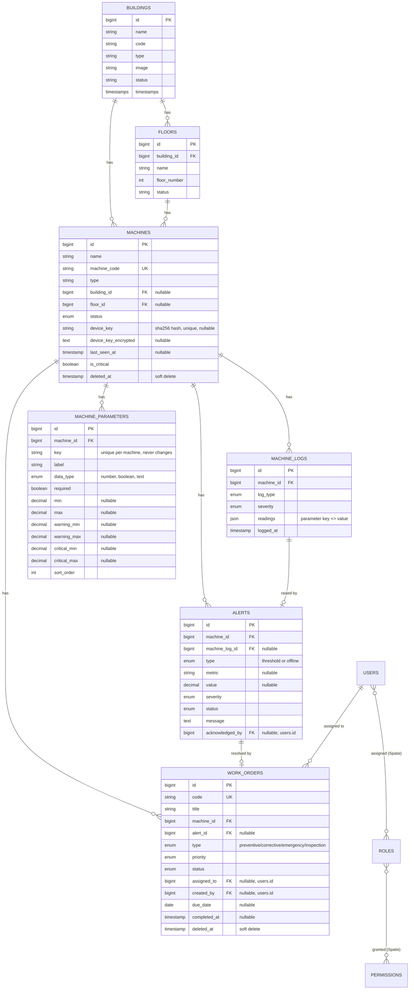

# Data Model

## Entity relationship diagram



`settings` and `activity_log` aren't shown above — neither has a foreign key into this graph (`settings` is a flat key-value store, `activity_log` references other tables only via a polymorphic `subject_type`/`subject_id`, not a real FK) — see their sections below. The `machine_statuses` and `log_types` placeholder tables (empty, `id`+`timestamps` only, never referenced by any query) were dropped in Phase 10.

## Tables

### `buildings`

Migration: [2026_02_18_074259_create_buildings_table.php](../database/migrations/2026_02_18_074259_create_buildings_table.php)

| Column | Type | Nullable | Notes |
|---|---|---|---|
| id | bigint PK | | |
| name | string | | |
| code | string | ✓ | building code, unique in practice (enforced at controller-validation level, not a DB constraint) |
| type | string | ✓ | one of: Production Facility, Warehouse, Office Building, R&D Center, Distribution Center (enforced by controller validation, not a DB enum) |
| image | string | ✓ | path under `storage/app/public/buildings` |
| address, city, state, country | string | ✓ | |
| year_built | integer | ✓ | |
| emergency_contact_name, emergency_contact_phone | string | ✓ | |
| status | string | ✓ | Operational, Under Construction, Maintenance, Inactive (controller-validated) |
| notes | text | ✓ | |
| timestamps | | | |

**Relationships** ([Building.php](../app/Models/Building.php)): `hasMany(Floor)`, `hasMany(Machine)`.

**Delete behaviour**: `Building::boot()` registers a `deleting` event that calls `$building->floors()->delete()` and `$building->machines()->delete()`. Floors have no soft-deletes, so this is a **hard delete**. Machines use `SoftDeletes`, so this is a **soft delete** (sets `deleted_at`). There is no DB-level `ON DELETE CASCADE` on these — the cascade is application-level, in the model's boot method.

### `floors`

Migration: [2026_02_18_082718_create_floors_table.php](../database/migrations/2026_02_18_082718_create_floors_table.php)

| Column | Type | Nullable | Notes |
|---|---|---|---|
| id | bigint PK | | |
| building_id | bigint FK → buildings.id | | `onDelete('cascade')` at the DB level |
| name | string | | |
| floor_number | integer | ✓ | |
| description | text | ✓ | |
| status | string | ✓ | active/inactive/maintenance (controller-validated) |
| timestamps | | | |

**Relationships** ([Floor.php](../app/Models/Floor.php)): `belongsTo(Building)`, `hasMany(Machine)`. No `SoftDeletes`.

### `machines`

Migrations: [2026_02_19_142824_create_machines_table.php](../database/migrations/2026_02_19_142824_create_machines_table.php), [add_device_key_to_machines_table](../database/migrations/2026_09_26_063758_add_device_key_to_machines_table.php), [add_device_key_encrypted_to_machines_table](../database/migrations/2026_09_26_070637_add_device_key_encrypted_to_machines_table.php), [add_machine_type_id_and_specifications_to_machines_table](../database/migrations/2026_09_27_202033_add_machine_type_id_and_specifications_to_machines_table.php), [backfill_machine_types_on_machines_table](../database/migrations/2026_09_27_202034_backfill_machine_types_on_machines_table.php), [drop_type_and_spec_columns_from_machines_table](../database/migrations/2026_09_27_202035_drop_type_and_spec_columns_from_machines_table.php)

| Column | Type | Nullable | Notes |
|---|---|---|---|
| id | bigint PK | | |
| name | string | | |
| machine_code | string | | **unique** |
| machine_type_id | bigint FK → machine_types.id | ✓ | `restrictOnDelete()` — a type in use by any machine (including a soft-deleted one) can't be deleted; see `machine_types` below |
| manufacturer, model_number, serial_number | string | ✓ | |
| building_id | bigint FK → buildings.id | ✓ | `onDelete('set null')`, indexed |
| floor_id | bigint FK → floors.id | ✓ | `onDelete('set null')`, indexed |
| description | text | ✓ | |
| specifications | json | ✓ | Keyed by the machine's `machineType->spec_fields` keys (e.g. `{"capacity_tons": 200}`) — replaces the old dedicated per-type spec columns. `MachineService::normalizeSpecifications()` strips any key that doesn't belong to the machine's current type before storage. |
| status | enum | | `active`, `inactive`, `maintenance`, `fault` — default `active` |
| power_rating | decimal(10,2) | ✓ | kW — every machine has this regardless of type, so it stayed a real column rather than moving into `specifications` |
| ip_address | string | ✓ | |
| installation_date, last_maintenance_date, next_maintenance_date | date | ✓ | |
| maintenance_interval_days | integer | ✓ | |
| spec_voltage | decimal(8,2) | ✓ | V — same reasoning as `power_rating` |
| is_critical | boolean | | default `false`, indexed |
| **device_key** | string(64) | ✓ | SHA-256 hash of the device's plaintext API key. **Unique.** Never exposed as plaintext — see below. |
| **device_key_encrypted** | text | ✓ | `Crypt::encryptString()` of the plaintext key, so it can be decrypted and shown again to an authorized user. |
| **last_seen_at** | timestamp | ✓ | Stamped to `now()` (not the reading's own `logged_at`) inside `MachineLogService::store()` every time any log is stored for this machine — a replayed backlog of old readings still proves the device is alive *now*. Not written by `AuthenticateDevice`; moved into the service in Phase 6 so every caller of `store()`, not just the sensor API, keeps offline detection accurate. Null means never commissioned/never reported — see `Machine::isOnline()` and the `alerts` "offline" type below. |
| deleted_at | timestamp | ✓ | `SoftDeletes` |
| timestamps | | | |

**Why two device-key columns?** `device_key` (a one-way hash) is what `AuthenticateDevice::handle()` looks up against on every sensor request — fast, indexed, unique, and even a full DB dump doesn't reveal a usable key. `device_key_encrypted` is a two-way encrypted copy (using the app's `APP_KEY`) that exists purely so a user with the `machines.view-device-key` permission can view/copy the key again later without regenerating it. See [Machine.php](../app/Models/Machine.php) (`generateDeviceKey()`, `decryptDeviceKey()`, `findByDeviceKey()`) and [06-security.md](06-security.md).

Both columns are in the model's `$hidden` array, so they never appear in `toArray()`/`toJson()` output even accidentally.

**Relationships** ([Machine.php](../app/Models/Machine.php)): `belongsTo(Building)`, `belongsTo(Floor)`, `belongsTo(MachineType)` (as `machineType()`), `hasMany(MachineLog)` (as `logs()`), `hasMany(MachineParameter)` (as `parameters()`, ordered by `sort_order`), `hasMany(Alert)` (as `alerts()`).

**Scopes**: `active()`, `critical()`, `byBuilding($id)`, `byFloor($id)`.

**Casts**: `specifications` cast to `array`, decimals cast to `decimal:2`/`decimal:3` strings, dates cast to `date`, `last_seen_at` cast to `datetime`, booleans cast to `boolean`.

### `machine_types`

Migrations: [2026_09_27_144009_create_machine_types_table.php](../database/migrations/2026_09_27_144009_create_machine_types_table.php), [2026_09_27_144010_seed_default_machine_types.php](../database/migrations/2026_09_27_144010_seed_default_machine_types.php)

Replaces the hard-coded `App\Enums\MachineType` (now removed) with a database-backed, admin-editable list — see `machine-types.*` in [04-routes.md](04-routes.md) and [06-security.md](06-security.md). Each type owns its own specification fields, so different types can collect different specs without a schema change. Every machine now references a type via `machines.machine_type_id`, with its own per-type values stored in `machines.specifications` (JSON) — see `machines` above.

| Column | Type | Nullable | Notes |
|---|---|---|---|
| id | bigint PK | | |
| name | string(100) | | **unique** |
| icon | string(16) | ✓ | A key from the predetermined `App\Enums\MachineTypeIcon` set (e.g. `cube`, `fire`, `lightning-bolt`), not free text — rendered as an inline SVG by `<x-machine-type-icon>`. Was a free-text emoji before `convert_machine_type_icons_to_keys`; see [08-frontend.md](08-frontend.md). |
| description | text | ✓ | |
| spec_fields | json | ✓ | An ordered list of field definitions — see below. Nullable because MySQL can't default a JSON column; application code always writes an array and reads it back with `?? []` (`MachineType::specFields()`). |
| timestamps | | | |

**`spec_fields` shape** — a JSON array of objects, one per field, each with a `key`, `label`, `type`, `required`, and whichever kind-specific settings apply to that `type`:

```json
[
  { "key": "capacity_tons", "label": "Capacity", "type": "number", "unit": "tons", "step": "0.01", "min": 0, "required": false },
  { "key": "fuel", "label": "Fuel", "type": "select", "options": ["Diesel", "Natural Gas"], "required": false },
  { "key": "autostart", "label": "Autostart", "type": "boolean", "required": false }
]
```

`type` is one of `App\Enums\SpecFieldType`'s cases — the single source of truth for which kinds exist and which settings each one takes:

| `type` | Kind-specific settings | `specifications` value |
|---|---|---|
| `text` | `placeholder` | string |
| `textarea` | `placeholder` | string |
| `number` | `unit`, `step`, `min`, `max` | float |
| `select` | `options` (required, ≥1) | string, one of `options` |
| `multiselect` | `options` (required, ≥1) | array of strings, each one of `options` |
| `boolean` | — | bool (always present once a machine of this type is saved — unlike every other kind, `false` is a real answer, not an absent one) |
| `date` | — | `Y-m-d` string |
| `url` | `placeholder` | string (`http`/`https` only) |
| `email` | `placeholder` | string |

Every kind also takes an optional `help` string, shown under the control on the machine form. `required` is meaningless for `boolean` (`SpecFieldType::supportsRequired()` is `false` for it) — the builder hides that checkbox for it, and `MachineTypeService` forces it to `false` regardless of what's posted. **`key` is generated once, from the label, when a field is first created, and never changes again** — it is what a machine's `specifications` JSON (see `machines` above) is indexed by, so renaming a field's label later can't orphan data already stored under its key, and *changing a field's `type` later* doesn't delete a machine's already-stored value either (it just won't display or validate correctly against the new kind until that machine is saved again). `MachineTypeService` enforces the key rule: a submitted `spec_fields.*.key` must already belong to the type being updated, or it's rejected.

A data migration, `convert_yes_no_spec_fields_to_boolean`, converted the seeded Generator's `autostart` and Cooling Tower's `makeup_valve` — both originally Text fields holding the string `"Yes"`/`"No"`, from before `boolean` existed as a kind — to real Boolean fields, and every machine of those types' stored value to a real `bool`.

**Relationships** ([MachineType.php](../app/Models/MachineType.php)): `hasMany(Machine)` (as `machines()`).

**Casts**: `spec_fields` cast to `array`.

**Deletion is blocked while any machine — including a soft-deleted one — is still assigned the type** (`MachineTypeService::isInUse()`/`delete()`); the FK on `machines.machine_type_id` also enforces this at the database level via `restrictOnDelete()`. The temporary `Schema::hasColumn('machines', 'machine_type_id')` rollout guards that used to sit in `isInUse()`/`getAllWithMachineCounts()` (needed while the column didn't exist yet) are gone now that it always does.

Seeded with nine types matching the specs the app's machine form used to hard-code per type (Chiller, Cooling Tower, Generator, Elevator, Pump, HVAC, Compressor, Boiler, Other) — see the seed migration for the exact field list per type.

### `machine_logs`

Migration: [2026_02_19_142853_create_machine_logs_table.php](../database/migrations/2026_02_19_142853_create_machine_logs_table.php)

This is the sensor/event log table — every reading from a device and every manual event (status change, maintenance note, alarm) is one row here.

| Column | Type | Nullable | Notes |
|---|---|---|---|
| id | bigint PK | | |
| machine_id | bigint FK → machines.id | | `onDelete('cascade')` |
| log_type | enum | | `status_change`, `maintenance`, `alarm`, `sensor_reading`, `operation`, `error` |
| event | string | ✓ | short description |
| severity | enum | | `info` (default), `warning`, `error`, `critical` |
| previous_status, current_status | string | ✓ | used for `status_change` logs |
| readings | json | ✓ | sensor values as `{parameter key: value}`, for the keys defined on the log's machine (see [`machine_parameters`](#machine_parameters)); numbers, booleans or strings per the parameter's `data_type`. Never holds a null value. Null when the log carries no readings (e.g. an alarm). Replaced the old fixed `temperature`/`humidity`/… columns |
| notes | text | ✓ | |
| performed_by | string | ✓ | free text — a user's name, or "system"/the device identifier |
| logged_at | timestamp | | defaults to `CURRENT_TIMESTAMP` at the DB level; app also defaults it in `MachineLogService::store()` if omitted |
| timestamps | | | separate from `logged_at` — `created_at`/`updated_at` track when the *row* was written, `logged_at` is when the *event* happened |

Indexes: `(machine_id, logged_at)`, `(log_type, severity)`, `logged_at`, `severity`.

**Relationships** ([MachineLog.php](../app/Models/MachineLog.php)): `belongsTo(Machine)`.

**Scopes**: `alerts()` (severity in error/critical), `byType($type)`, `recent($days = 7)`, `bySeverity($severity)`.

**Retention**: `MachineLog` uses Laravel's `Prunable` trait — rows older than the `log_retention_days`, and the outgoing-email keys `mail_host`, `mail_port`, `mail_username`, `mail_password` (stored **encrypted**), `mail_encryption`, `mail_from_address`, `mail_from_name`, `app_url` setting (default 365) are deleted daily by the scheduled `model:prune` command. See [02-architecture.md](02-architecture.md#data-retention-prunable-machinelog).

> **Alert limits - how they are read.** For a number parameter: *critical* when the reading is **below `critical_min` or above `critical_max`**; otherwise *warning* when **below `warning_min` or above `warning_max`**; otherwise normal (`MachineParameter::severityFor()` - the one definition, used by `AlertService` and the machine page). So "critical below" must be the **lower** number and "critical above" the **higher** one. Entering "warning 60-80, critical 81-100" as ranges makes every reading under 81 critical. The Edit page labels the boxes, shows the rule as a sentence and rejects contradictions on save (`MachineController::limitRule()`); `MachineParameter::thresholdProblems()` reports them for limits saved before that.

### `machine_parameters`

Migration: [2026_10_07_175019_create_machine_parameters_table.php](../database/migrations/2026_10_07_175019_create_machine_parameters_table.php)

The readings a specific machine reports through the sensor API (`machine_logs.readings`), defined per machine on its edit page. **Separate from a machine type's specification fields**: those describe the machine (capacity, fuel…); these are the live values its device sends. A number parameter also carries its accepted range and its alert thresholds — `AlertService::evaluate()` checks every incoming reading against them. This table replaced both the fixed sensor columns on `machine_logs` and the old `sensor_thresholds` table (see [CHANGELOG.md](CHANGELOG.md), Phase 10).

| Column | Type | Nullable | Notes |
|---|---|---|---|
| id | bigint PK | | |
| machine_id | bigint FK → machines.id | | `cascadeOnDelete()` |
| key | string(50) | | the name used inside a POST's `readings` object. Generated from the label (or typed on a new row); **never changed after creation** — stored readings and device firmware refer to it. Matches `^[a-z][a-z0-9_]*$` |
| label | string | | shown in the chart dropdown, logs table, alerts and AI context |
| unit | string(30) | ✓ | e.g. `°C` |
| data_type | enum | | `number` (default), `boolean`, `text` — never changed after creation (`App\Enums\ParameterDataType`) |
| required | boolean | | must be present in every `sensor_reading` log (not enforced for other log types) |
| min, max | decimal(16,4) | ✓ | number only — accepted range; a value outside it is rejected by the API |
| warning_min, warning_max | decimal(16,4) | ✓ | number only — a null bound means that side isn't checked |
| critical_min, critical_max | decimal(16,4) | ✓ | number only — checked before the warning bounds, see `AlertService::determineSeverity()` |
| sort_order | unsigned int | | display order, from the row's position in the form |
| timestamps | | | |

Unique on `(machine_id, key)`. Bounds are cleared for a non-number parameter by `MachineParameterService`, which also owns the rules above.

**Relationships** ([MachineParameter.php](../app/Models/MachineParameter.php)): `belongsTo(Machine)`.
### `alerts`

Migration: [2026_09_26_191411_create_alerts_table.php](../database/migrations/2026_09_26_191411_create_alerts_table.php)

A threshold breach or a device-offline event raised against a machine. Created/escalated/auto-resolved by `AlertService`.

| Column | Type | Nullable | Notes |
|---|---|---|---|
| id | bigint PK | | |
| machine_id | bigint FK → machines.id | | `onDelete('cascade')` |
| machine_log_id | bigint FK → machine_logs.id | ✓ | the reading that raised/last updated this alert; **always null for an `offline` alert** — it isn't caused by any one reading; `nullOnDelete()` |
| type | enum | | `threshold` (default) or `offline` |
| metric | string | ✓ | the key of the `machine_parameters` row that was breached, for a threshold alert; **always null for `offline`**. Not a foreign key — it survives the parameter being deleted |
| value | decimal(12,3) | ✓ | the reading that triggered/last updated this alert; **always null for `offline`** |
| severity | enum | | `warning`, `critical` — no `info` level exists, so even an offline alert must pick one of these two (see below) |
| status | enum | | `open` (default), `acknowledged`, `resolved` |
| message | text | | human-readable summary; `AlertService::buildMessage()` for a threshold alert, `buildOfflineMessage()` for an offline one — the latter uses an **absolute** timestamp (`format('M d, Y H:i')`), never `diffForHumans()`, since the text is stored and would go stale |
| acknowledged_by | bigint FK → users.id | ✓ | `nullOnDelete()` |
| acknowledged_at | timestamp | ✓ | |
| resolved_at | timestamp | ✓ | |
| resolved_by | bigint FK → users.id | ✓ | `nullOnDelete()`; null when the system resolved it |
| resolution | string(30) | ✓ | `manual`, `auto`, `work_order` or `device_back_online` |
| timestamps | | | |

Indexes: `(machine_id, metric, status)` (the lookup `AlertService::evaluate()` does on every reading), `type`, `status`.

**Relationships** ([Alert.php](../app/Models/Alert.php)): `belongsTo(Machine)`, `belongsTo(MachineLog)`, `belongsTo(User, 'acknowledged_by')` (as `acknowledgedBy()`).

**Scopes**: `open()` (status = open). Note `AlertService::evaluate()` looks for an alert in **`open` or `acknowledged`** (not just `open`): an acknowledged alert still auto-resolves when the reading recovers, and a new breach reuses it instead of opening a duplicate. If an acknowledged alert becomes critical it is **re-opened** (`escalated`, acknowledgement cleared) and notified again.

**`alert_events`** - the alert trail: one row per thing that happened to an alert, appended by `AlertService::recordEvent()` (the only place alert state changes are made), never edited.

| Column | Notes |
|---|---|
| `alert_id` | FK, cascade |
| `user_id` | FK, `nullOnDelete`; **null = the system** (a device reading, the scheduler) |
| `action` | `raised`, `escalated`, `acknowledged`, `resolved`, `auto_resolved`, `resolved_by_work_order`, `device_back_online` |
| `from_status`, `to_status` | the status change, when there was one |
| `severity`, `value` | severity at the time and the reading that caused it |
| `note`, `created_at` | (no `updated_at`) |

Index `(alert_id, created_at)`. Alerts that predate the table were backfilled with raised/acknowledged/resolved rows by the migration. Shown on the alert page (`alerts.show`) and as the machine page's **Alert trail**.

**Threshold alert rules enforced in `AlertService`, not the schema**: at most one **open** alert per `(machine_id, metric)` at a time — a second breach updates the existing row (raising `severity` from `warning` to `critical` if the new reading is worse, never downgrading it) rather than inserting a new row; a reading back within both bounds auto-resolves whatever was **open** (not acknowledged) for that metric.

**Offline alert rules** (`AlertService::raiseOfflineAlerts()`/`resolveOfflineAlerts()`, Phase 6):
- Raised by the scheduled `app:check-offline-devices` command for any machine where `last_seen_at` is non-null, older than the threshold (10 minutes by default — `AlertInterface::OFFLINE_AFTER_MINUTES`), status isn't `inactive`, and no `offline` alert is already `open`/`acknowledged` for it. `last_seen_at IS NULL` (never commissioned) is deliberately **not** treated as offline — an outage requires having reported at least once.
- Severity is `critical` if `machine.is_critical`, else `warning` — a direct, permanent mapping (there's no third option, since the enum has no `info`).
- At most one open-or-acknowledged offline alert per machine at a time; the command's query itself is the dedupe, so running it every minute never re-raises or re-notifies for a machine already flagged.
- Resolved from **both** `open` and `acknowledged` status the moment any new log is stored for the machine (inside `AlertService::evaluate()`, which every call to `MachineLogService::store()` runs) — unlike a threshold alert, whether the device is back online is objective, so there's no reason to leave an acknowledged one hanging and every reason to let it clear so the dedupe above works correctly on the next real outage.

### `work_orders`

Migrations: [2026_02_18_080220_create_work_orders_table.php](../database/migrations/2026_02_18_080220_create_work_orders_table.php) (original placeholder, `id`+`timestamps` only) and [2026_09_26_202345_add_details_to_work_orders_table.php](../database/migrations/2026_09_26_202345_add_details_to_work_orders_table.php) (Phase 7 — every real column).

A maintenance or repair task against a machine, optionally originating from an alert.

| Column | Type | Nullable | Notes |
|---|---|---|---|
| id | bigint PK | | |
| code | string | | unique display id, e.g. `WO-2026-0001`; generated by `WorkOrderService::generateCode()` (year + a 4-digit sequence counted within that year) |
| title | string | | |
| description | text | ✓ | |
| machine_id | bigint FK → machines.id | | `onDelete('cascade')` |
| alert_id | bigint FK → alerts.id | ✓ | set only when created directly from an open alert (e.g. the "Create Work Order" button on an alert row); `nullOnDelete()` |
| type | enum | | `preventive`, `corrective` (default), `emergency`, `inspection` |
| priority | enum | | `low`, `medium` (default), `high`, `urgent` |
| status | enum | | `pending` (default), `in_progress`, `completed`, `cancelled` |
| assigned_to | bigint FK → users.id | ✓ | the technician (or anyone) responsible; `nullOnDelete()` |
| created_by | bigint FK → users.id | ✓ | who created it; `nullOnDelete()` — nullable so a future system-generated preventive work order (Phase 8) doesn't need a synthetic user |
| due_date | date | ✓ | |
| started_at | timestamp | ✓ | stamped when status first becomes `in_progress` |
| completed_at | timestamp | ✓ | stamped when status becomes `completed` |
| resolution_notes | text | ✓ | free text describing what was done, captured on completion |
| deleted_at | timestamp | ✓ | `SoftDeletes` |
| timestamps | | | |

Indexes: `(status, priority)`, `machine_id`, `assigned_to`.

**Relationships** ([WorkOrder.php](../app/Models/WorkOrder.php)): `belongsTo(Machine)`, `belongsTo(Alert)`, `belongsTo(User, 'assigned_to')` (as `assignedTo()`), `belongsTo(User, 'created_by')` (as `createdBy()`).

**Scopes**: `open()` (status in `pending`/`in_progress`).

**Rules enforced in `WorkOrderService`, not the schema**:
- **Only the assignee, or anyone holding the broader `work-orders.update` permission, may change a work order's status** (`updateStatus()` throws `WorkOrderActionException` otherwise) — this is what "technicians update only their own" means in practice: a technician has `work-orders.update-status` but not `work-orders.update`, so the check falls through to comparing `assigned_to` against the acting user; a manager/admin has `work-orders.update` and can touch any work order.
- **Completing a work order with a non-null `alert_id` resolves that alert** via `AlertInterface::resolve()`.
- **Completing a `preventive` work order advances the machine's maintenance schedule**: `machines.last_maintenance_date` is set to today and `next_maintenance_date` to today plus `machines.maintenance_interval_days` (falling back to 90 if that column is null).
- **Creating a work order with an assignee, or reassigning one to a new assignee, sends `WorkOrderAssignedNotification`** (database + mail, `ShouldQueue`) to that one user — unlike alert notifications (broadcast to every admin/manager), a work order has exactly one assignee.
- `code` has a database-level unique constraint as a backstop, but generation itself isn't concurrency-locked — acceptable at this app's scale, the same trade-off already made for `machine_code`.
- **`generatePreventiveWorkOrders(int $leadDays)`** (Phase 8, run daily by `app:generate-preventive-work-orders`): creates a `preventive` work order, `created_by` null, for every machine with a non-null `next_maintenance_date` at or before `today + $leadDays`, excluding `inactive` machines and any machine that already has an open (`pending`/`in_progress`) preventive work order — that existing-open check is the dedupe, so running it twice in a row (or missing a day) never creates a duplicate. Priority is `high` if the machine is already overdue, else `medium`; `due_date` is set to the machine's `next_maintenance_date`. The same `inactive`-machine exclusion is applied by `MaintenanceService` to every dashboard count, so a machine the generator would skip also never shows as "overdue" on the dashboard.

### `settings`

Migration: [2026_09_27_051526_create_settings_table.php](../database/migrations/2026_09_27_051526_create_settings_table.php).

A generic key-value store — one row per setting, rather than one column per setting on some singleton table — read and written exclusively through the cached `SettingInterface`/`SettingService` (see [02-architecture.md](02-architecture.md#container-binding-registry)), never queried directly.

| Column | Type | Nullable | Notes |
|---|---|---|---|
| id | bigint PK | | |
| key | string | | unique; one of `SettingInterface::KEYS` |
| value | text | ✓ | JSON-encoded (`json_encode`/`json_decode`), so a value can be a string, number, bool, or array (e.g. `alert_emails`) |
| timestamps | | | |

**Keys** (`SettingInterface::KEYS` / `::DEFAULTS`): `company_name`, `alert_emails` (array of strings), `offline_timeout_minutes`, `preventive_lead_days`, `auto_fault_on_critical` (bool), `log_retention_days`. A key with no row falls back to its default — `SettingService::all()` merges stored values over `DEFAULTS`, so a fresh install (or a key added later without a migration) never crashes on a missing setting.

`SettingService` caches the merged result forever under `app.settings` and calls `Cache::forget()` on every `update()` — see [02-architecture.md](02-architecture.md#container-binding-registry) for consumers (the offline/preventive commands, `AlertService`, `MachineService`, `MachineLog::prunable()`, the sidebar's company name).

### `activity_log`

Migrations: [2026_09_27_052350_create_activity_log_table.php](../database/migrations/2026_09_27_052350_create_activity_log_table.php), [..._add_event_column...](../database/migrations/2026_09_27_052351_add_event_column_to_activity_log_table.php), [..._add_batch_uuid_column...](../database/migrations/2026_09_27_052352_add_batch_uuid_column_to_activity_log_table.php) — stock `spatie/laravel-activitylog` migrations, unmodified.

| Column | Type | Nullable | Notes |
|---|---|---|---|
| id | bigint PK | | |
| log_name | string | ✓ | defaults to `default`; unused here (single log name across all models) |
| description | string | | e.g. `created`, `updated` |
| subject_type / subject_id | morph | ✓ | the model the activity happened to — `Machine`, `Building`, `WorkOrder`, or `Alert` |
| event | string | ✓ | `created`/`updated`/`deleted` (added by the second migration) |
| causer_type / causer_id | morph | ✓ | who did it — the authenticated `User`, resolved automatically from the request; null for a system/console action (e.g. the preventive-work-order generator) |
| properties | json | ✓ | `{"attributes": {...new values...}, "old": {...previous values...}}` for an `updated` event |
| batch_uuid | uuid | ✓ | groups activities logged in the same `LogBatch` (added by the third migration; unused — no code opens a batch) |
| timestamps | | | |

See [02-architecture.md](02-architecture.md#audit-logging-spatielaravel-activitylog) for which models log, why `Alert` logs a narrower column set than the others, and how the machine page's combined Activity feed queries this table.

### `groups` and `group_user`

Migration: [create_groups_table.php](../database/migrations/2026_10_11_165424_create_groups_table.php).

A group is a named set of users that shares roles/permissions and can be a machine's **assignment group**.

| Column | Type | Notes |
|---|---|---|
| `groups.id`, `name` (unique), `description` (nullable), timestamps | | |
| `group_user.group_id`, `user_id` | FKs, cascade | composite primary key; a user can be in many groups |

A `Group` uses Spatie's `HasRoles`, so its roles and direct permissions live in the same `model_has_roles` / `model_has_permissions` tables as a user's (`model_type = App\Models\Group`). It must declare `$guard_name = 'web'`. `User::hasPermissionTo()` also asks the user's groups, which is how a member inherits them - see [06-security.md](06-security.md#groups).

`machines.assignment_group_id` (migration `add_assignment_group_id_to_machines_table`): nullable FK to `groups`, `nullOnDelete`. Its members are emailed when the machine raises an alert (`AlertService::notify()`).

### Auth & permissions tables

- **`users`** — standard Laravel auth table (`name`, `email`, `password`, etc.). Uses Spatie's `HasRoles` trait.
- **`personal_access_tokens`** — Sanctum, used only by `GET /api/user`.
- **`permissions`**, **`roles`**, **`model_has_permissions`**, **`model_has_roles`**, **`role_has_permissions`** — standard Spatie `laravel-permission` tables, created by [create_permission_tables.php](../database/migrations/2026_09_26_070622_create_permission_tables.php). See [06-security.md](06-security.md) for the roles/permissions currently defined.

### Framework tables

`cache`, `cache_locks`, `jobs`, `job_batches`, `failed_jobs`, `sessions`, `password_reset_tokens` — standard Laravel framework tables, no application-specific columns.

`notifications` — standard Laravel notifications table ([2026_09_26_191412_create_notifications_table.php](../database/migrations/2026_09_26_191412_create_notifications_table.php)), backing the `database` channel `MachineAlertNotification` uses and the header bell's unread count/dropdown (`$user->unreadNotifications`).
