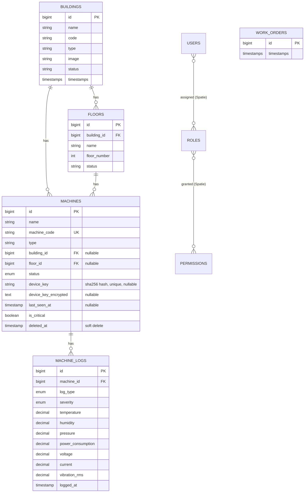

# Data Model

## Entity relationship diagram

`WORK_ORDERS`, `MACHINE_STATUSES` and `LOG_TYPES` are currently empty placeholder tables (`id` + `timestamps` only) — see [Placeholder tables](#placeholder-tables-not-yet-used) below.

## Tables

### `buildings`

Migration: [2026_02_18_074259_create_buildings_table.php](../database/migrations/2026_02_18_074259_create_buildings_table.php)

| Column | Type | Nullable | Notes |
|---|---|---|---|
| id | bigint PK | | |
| name | string | | |
| code | string | ✓ | building code, unique in practice (enforced at controller-validation level, not a DB constraint) |
| type | string | ✓ | one of: Production Facility, Warehouse, Office Building, R&D Center, Distribution Center (enforced by controller validation, not a DB enum) |
| image | string | ✓ | path under `storage/app/public/buildings` |
| address, city, state, country | string | ✓ | |
| year_built | integer | ✓ | |
| emergency_contact_name, emergency_contact_phone | string | ✓ | |
| status | string | ✓ | Operational, Under Construction, Maintenance, Inactive (controller-validated) |
| notes | text | ✓ | |
| timestamps | | | |

**Relationships** ([Building.php](../app/Models/Building.php)): `hasMany(Floor)`, `hasMany(Machine)`.

**Delete behaviour**: `Building::boot()` registers a `deleting` event that calls `$building->floors()->delete()` and `$building->machines()->delete()`. Floors have no soft-deletes, so this is a **hard delete**. Machines use `SoftDeletes`, so this is a **soft delete** (sets `deleted_at`). There is no DB-level `ON DELETE CASCADE` on these — the cascade is application-level, in the model's boot method.

### `floors`

Migration: [2026_02_18_082718_create_floors_table.php](../database/migrations/2026_02_18_082718_create_floors_table.php)

| Column | Type | Nullable | Notes |
|---|---|---|---|
| id | bigint PK | | |
| building_id | bigint FK → buildings.id | | `onDelete('cascade')` at the DB level |
| name | string | | |
| floor_number | integer | ✓ | |
| description | text | ✓ | |
| status | string | ✓ | active/inactive/maintenance (controller-validated) |
| timestamps | | | |

**Relationships** ([Floor.php](../app/Models/Floor.php)): `belongsTo(Building)`, `hasMany(Machine)`. No `SoftDeletes`.

### `machines`

Migrations: [2026_02_19_142824_create_machines_table.php](../database/migrations/2026_02_19_142824_create_machines_table.php), [add_device_key_to_machines_table](../database/migrations/2026_09_26_063758_add_device_key_to_machines_table.php), [add_device_key_encrypted_to_machines_table](../database/migrations/2026_09_26_070637_add_device_key_encrypted_to_machines_table.php)

| Column | Type | Nullable | Notes |
|---|---|---|---|
| id | bigint PK | | |
| name | string | | |
| machine_code | string | | **unique** |
| type | string | | HVAC, Generator, Elevator, Pump, etc. — free text, indexed |
| manufacturer, model_number, serial_number | string | ✓ | |
| building_id | bigint FK → buildings.id | ✓ | `onDelete('set null')`, indexed |
| floor_id | bigint FK → floors.id | ✓ | `onDelete('set null')`, indexed |
| description | text | ✓ | |
| status | enum | | `active`, `inactive`, `maintenance`, `fault` — default `active` |
| power_rating | decimal(10,2) | ✓ | kW |
| ip_address | string | ✓ | |
| installation_date, last_maintenance_date, next_maintenance_date | date | ✓ | |
| maintenance_interval_days | integer | ✓ | |
| capacity_tons, spec_voltage, fuel, autostart | mixed | ✓ | HVAC/generator-specific specs |
| capacity_persons, speed_m_s | mixed | ✓ | elevator-specific specs |
| flow_lpm, head_m | mixed | ✓ | pump-specific specs |
| cells, makeup_valve | mixed | ✓ | cooling-tower-specific specs |
| is_critical | boolean | | default `false`, indexed |
| **device_key** | string(64) | ✓ | SHA-256 hash of the device's plaintext API key. **Unique.** Never exposed as plaintext — see below. |
| **device_key_encrypted** | text | ✓ | `Crypt::encryptString()` of the plaintext key, so it can be decrypted and shown again to an authorized user. |
| **last_seen_at** | timestamp | ✓ | Stamped to `now()` (not the reading's own `logged_at`) inside `MachineLogService::store()` every time any log is stored for this machine — a replayed backlog of old readings still proves the device is alive *now*. Not written by `AuthenticateDevice`; moved into the service in Phase 6 so every caller of `store()`, not just the sensor API, keeps offline detection accurate. Null means never commissioned/never reported — see `Machine::isOnline()` and the `alerts` "offline" type below. |
| deleted_at | timestamp | ✓ | `SoftDeletes` |
| timestamps | | | |

**Why two device-key columns?** `device_key` (a one-way hash) is what `AuthenticateDevice::handle()` looks up against on every sensor request — fast, indexed, unique, and even a full DB dump doesn't reveal a usable key. `device_key_encrypted` is a two-way encrypted copy (using the app's `APP_KEY`) that exists purely so a user with the `machines.view-device-key` permission can view/copy the key again later without regenerating it. See [Machine.php](../app/Models/Machine.php) (`generateDeviceKey()`, `decryptDeviceKey()`, `findByDeviceKey()`) and [06-security.md](06-security.md).

Both columns are in the model's `$hidden` array, so they never appear in `toArray()`/`toJson()` output even accidentally.

**Relationships** ([Machine.php](../app/Models/Machine.php)): `belongsTo(Building)`, `belongsTo(Floor)`, `hasMany(MachineLog)` (as `logs()`), `hasMany(SensorThreshold)` (as `thresholds()`), `hasMany(Alert)` (as `alerts()`).

**Scopes**: `active()`, `critical()`, `byBuilding($id)`, `byFloor($id)`.

**Casts**: decimals cast to `decimal:2`/`decimal:3` strings, dates cast to `date`, `last_seen_at` cast to `datetime`, booleans cast to `boolean`.

### `machine_logs`

Migration: [2026_02_19_142853_create_machine_logs_table.php](../database/migrations/2026_02_19_142853_create_machine_logs_table.php)

This is the sensor/event log table — every reading from a device and every manual event (status change, maintenance note, alarm) is one row here.

| Column | Type | Nullable | Notes |
|---|---|---|---|
| id | bigint PK | | |
| machine_id | bigint FK → machines.id | | `onDelete('cascade')` |
| log_type | enum | | `status_change`, `maintenance`, `alarm`, `sensor_reading`, `operation`, `error` |
| event | string | ✓ | short description |
| severity | enum | | `info` (default), `warning`, `error`, `critical` |
| previous_status, current_status | string | ✓ | used for `status_change` logs |
| temperature | decimal(8,2) | ✓ | °C, can be negative |
| humidity | decimal(5,2) | ✓ | 0–100% |
| pressure | decimal(10,2) | ✓ | bar, can be negative |
| power_consumption | decimal(10,2) | ✓ | kW, non-negative |
| voltage | decimal(8,2) | ✓ | non-negative |
| current | decimal(8,2) | ✓ | non-negative |
| frequency | decimal(8,2) | ✓ | non-negative |
| runtime_hours | integer | ✓ | non-negative |
| vibration_rms | decimal(8,3) | ✓ | non-negative |
| bearing_temp | decimal(8,2) | ✓ | °C, can be negative |
| oil_level | decimal(6,2) | ✓ | non-negative |
| notes | text | ✓ | |
| performed_by | string | ✓ | free text — a user's name, or "system"/the device identifier |
| logged_at | timestamp | | defaults to `CURRENT_TIMESTAMP` at the DB level; app also defaults it in `MachineLogService::store()` if omitted |
| timestamps | | | separate from `logged_at` — `created_at`/`updated_at` track when the *row* was written, `logged_at` is when the *event* happened |

Indexes: `(machine_id, logged_at)`, `(log_type, severity)`, `logged_at`, `severity`.

**Relationships** ([MachineLog.php](../app/Models/MachineLog.php)): `belongsTo(Machine)`.

**Scopes**: `alerts()` (severity in error/critical), `byType($type)`, `recent($days = 7)`, `bySeverity($severity)`.

### `sensor_thresholds`

Migration: [2026_09_26_191411_create_sensor_thresholds_table.php](../database/migrations/2026_09_26_191411_create_sensor_thresholds_table.php)

Per-machine, per-metric warning/critical bounds, configured on the machine edit page. `AlertService::evaluate()` checks every incoming `machine_logs` row against these.

| Column | Type | Nullable | Notes |
|---|---|---|---|
| id | bigint PK | | |
| machine_id | bigint FK → machines.id | | `onDelete('cascade')` |
| metric | enum | | one of `temperature`, `humidity`, `pressure`, `power_consumption`, `voltage`, `current`, `frequency`, `vibration_rms`, `bearing_temp`, `oil_level` — matches a `machine_logs` column |
| warning_min, warning_max | decimal(12,3) | ✓ | a null bound means that side isn't checked |
| critical_min, critical_max | decimal(12,3) | ✓ | checked before the warning bounds — see `AlertService::determineSeverity()` |
| timestamps | | | |

Unique on `(machine_id, metric)` — one threshold row per machine per metric. A metric with all four bounds empty has no row at all (removed by `AlertService::saveThresholds()` rather than stored as all-null).

**Relationships** ([SensorThreshold.php](../app/Models/SensorThreshold.php)): `belongsTo(Machine)`.

### `alerts`

Migration: [2026_09_26_191411_create_alerts_table.php](../database/migrations/2026_09_26_191411_create_alerts_table.php)

A threshold breach or a device-offline event raised against a machine. Created/escalated/auto-resolved by `AlertService`.

| Column | Type | Nullable | Notes |
|---|---|---|---|
| id | bigint PK | | |
| machine_id | bigint FK → machines.id | | `onDelete('cascade')` |
| machine_log_id | bigint FK → machine_logs.id | ✓ | the reading that raised/last updated this alert; **always null for an `offline` alert** — it isn't caused by any one reading; `nullOnDelete()` |
| type | enum | | `threshold` (default) or `offline` |
| metric | string | ✓ | one of the `sensor_thresholds.metric` values for a threshold alert; **always null for `offline`** |
| value | decimal(12,3) | ✓ | the reading that triggered/last updated this alert; **always null for `offline`** |
| severity | enum | | `warning`, `critical` — no `info` level exists, so even an offline alert must pick one of these two (see below) |
| status | enum | | `open` (default), `acknowledged`, `resolved` |
| message | text | | human-readable summary; `AlertService::buildMessage()` for a threshold alert, `buildOfflineMessage()` for an offline one — the latter uses an **absolute** timestamp (`format('M d, Y H:i')`), never `diffForHumans()`, since the text is stored and would go stale |
| acknowledged_by | bigint FK → users.id | ✓ | `nullOnDelete()` |
| acknowledged_at | timestamp | ✓ | |
| resolved_at | timestamp | ✓ | |
| timestamps | | | |

Indexes: `(machine_id, metric, status)` (the lookup `AlertService::evaluate()` does on every reading), `type`, `status`.

**Relationships** ([Alert.php](../app/Models/Alert.php)): `belongsTo(Machine)`, `belongsTo(MachineLog)`, `belongsTo(User, 'acknowledged_by')` (as `acknowledgedBy()`).

**Scopes**: `open()` (status = open).

**Threshold alert rules enforced in `AlertService`, not the schema**: at most one **open** alert per `(machine_id, metric)` at a time — a second breach updates the existing row (raising `severity` from `warning` to `critical` if the new reading is worse, never downgrading it) rather than inserting a new row; a reading back within both bounds auto-resolves whatever was **open** (not acknowledged) for that metric.

**Offline alert rules** (`AlertService::raiseOfflineAlerts()`/`resolveOfflineAlerts()`, Phase 6):
- Raised by the scheduled `app:check-offline-devices` command for any machine where `last_seen_at` is non-null, older than the threshold (10 minutes by default — `AlertInterface::OFFLINE_AFTER_MINUTES`), status isn't `inactive`, and no `offline` alert is already `open`/`acknowledged` for it. `last_seen_at IS NULL` (never commissioned) is deliberately **not** treated as offline — an outage requires having reported at least once.
- Severity is `critical` if `machine.is_critical`, else `warning` — a direct, permanent mapping (there's no third option, since the enum has no `info`).
- At most one open-or-acknowledged offline alert per machine at a time; the command's query itself is the dedupe, so running it every minute never re-raises or re-notifies for a machine already flagged.
- Resolved from **both** `open` and `acknowledged` status the moment any new log is stored for the machine (inside `AlertService::evaluate()`, which every call to `MachineLogService::store()` runs) — unlike a threshold alert, whether the device is back online is objective, so there's no reason to leave an acknowledged one hanging and every reason to let it clear so the dedupe above works correctly on the next real outage.

### Placeholder tables (not yet used)

These three tables exist as migrations but have **no columns beyond `id` and `timestamps`**, and their models ([WorkOrder.php](../app/Models/WorkOrder.php), [MachineStatus.php](../app/Models/MachineStatus.php), [LogType.php](../app/Models/LogType.php)) have no fillable/casts/relations:

- **`work_orders`** — will be built out in Phase 7 with real columns (title, machine_id, priority, status, assigned_to, etc.).
- **`machine_statuses`** — not used; `machines.status` is a plain enum column instead. Planned for removal in Phase 10.
- **`log_types`** — not used; `machine_logs.log_type` is a plain enum column instead. Planned for removal in Phase 10.

### Auth & permissions tables

- **`users`** — standard Laravel auth table (`name`, `email`, `password`, etc.). Uses Spatie's `HasRoles` trait.
- **`personal_access_tokens`** — Sanctum, used only by `GET /api/user`.
- **`permissions`**, **`roles`**, **`model_has_permissions`**, **`model_has_roles`**, **`role_has_permissions`** — standard Spatie `laravel-permission` tables, created by [create_permission_tables.php](../database/migrations/2026_09_26_070622_create_permission_tables.php). See [06-security.md](06-security.md) for the roles/permissions currently defined.

### Framework tables

`cache`, `cache_locks`, `jobs`, `job_batches`, `failed_jobs`, `sessions`, `password_reset_tokens` — standard Laravel framework tables, no application-specific columns.

`notifications` — standard Laravel notifications table ([2026_09_26_191412_create_notifications_table.php](../database/migrations/2026_09_26_191412_create_notifications_table.php)), backing the `database` channel `MachineAlertNotification` uses and the header bell's unread count/dropdown (`$user->unreadNotifications`).
